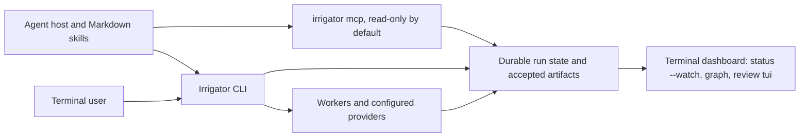

# Architecture and source map

Irrigator is a local Go executable whose durable run state controls scheduling,
artifact acceptance, execution identity, and budget reservations. Its terminal
commands and [read-only MCP server](mcp.md) display that state. Markdown skills instruct a
host agent to operate the executable; they are not an alternate runtime.

Paths below are relative to the repository root, the directory with
[go.mod](../go.mod). The executable is the root [main.go](../main.go), a
`package main` with one file; the runtime lives in
`internal/<domain>` packages (below). The module root stays here; there is no published
importable runtime library. Build with `make build` or `go build -o irrigator .`.

The top-level directories separate the product surfaces:

- `main.go`: the entry point only (`os.Exit(cli.Main(os.Args))`).
- `internal/`: the runtime, one package per responsibility ([package layout](#package-layout-and-layers)).
  Unit tests sit beside the code they test; integration tests (build tag `integration`, files
  named `*_integration_test.go`) live in `internal/cli`; black-box CLI contracts are in `e2e/`.
- `skills/`, `docs/`, and `examples/`: host workflows, contracts, and runnable plans.
- `tools/` and `verification/`: local build helpers and acceptance checks.

## Package layout and layers

A package may import only packages in a strictly lower layer; the Go compiler already rejects cycles,
and each package's `doc.go` records its layer and its actual imports. Read the table bottom-up: leaves
first, `cli` on top (it imports nearly every other package; nothing imports it except the root `main` package and integration tests).

| Layer | Package | What it is | Imports (internal) |
| ---: | --- | --- | --- |
| 0 | [clock](../internal/clock/doc.go) | swappable time source | none |
| 1 | [cost](../internal/cost/doc.go) | integer micro-dollar accounting | none |
| 2 | [buildinfo](../internal/buildinfo/doc.go) | the version constant | none |
| 3 | [jsonio](../internal/jsonio/doc.go) | strict JSON decode, atomic JSON write, JSON output | none |
| 4 | [localfs](../internal/localfs/doc.go) | confined, no-symlink filesystem helpers | none |
| 5 | [terminalview](../internal/terminalview/doc.go) | pure terminal frame, OSC and link rendering | none |
| 6 | [commandflags](../internal/commandflags/doc.go) | subcommand flag parsing and command metadata | none |
| 7 | [model](../internal/model/doc.go) | shared contracts: State, Plan, Task, Event, worker protocol | cost, jsonio |
| 8 | [launch](../internal/launch/doc.go) | execution profiles, sandbox, launch context, process supervision | buildinfo, clock, commandflags, jsonio, localfs, model |
| 9 | [artifactstore](../internal/artifactstore/doc.go) | immutable verified artifacts and the plan/artifact schema | jsonio, model |
| 10 | [checkpoint](../internal/checkpoint/doc.go) | the run directory: lock, read, validate, update, recovery gates | artifactstore, commandflags, cost, jsonio, launch, localfs, model, store |
| 11 | [managed](../internal/managed/doc.go) | managed provider adapters and budgeting | artifactstore, checkpoint, clock, cost, jsonio, launch, localfs, model, providerenv |
| 12 | [graph](../internal/graph/doc.go) | task-graph growth, turns, revisions, delivery status | artifactstore, checkpoint, commandflags, cost, jsonio, launch, managed, model |
| 13 | [messaging](../internal/messaging/doc.go) | mailbox and experiment channels | checkpoint, commandflags, jsonio, launch, localfs, model, review, textsafe |
| 14 | [campaign](../internal/campaign/doc.go) | campaign admit and close | checkpoint, commandflags, jsonio, launch, model |
| 15 | [composition](../internal/composition/doc.go) | typed compositions compiled to plans | artifactstore, checkpoint, commandflags, jsonio, launch, model |
| 16 | [observer](../internal/observer/doc.go) | shape, lifecycle and budget projections | checkpoint, jsonio, model |
| 17 | [sizing](../internal/sizing/doc.go) | plan sizing and the admission gate | checkpoint, cost, jsonio, model |
| 18 | [backup](../internal/backup/doc.go) | run backup and recovery transfer | checkpoint, commandflags, jsonio, launch, managed, model |
| 19 | [provider](../internal/provider/doc.go) | provider pool, migration, billing and cost statements | artifactstore, checkpoint, commandflags, cost, graph, jsonio, launch, localfs, managed, model, observer, providerenv |
| 20 | [executor](../internal/executor/doc.go) | running one task attempt: executors, cleanup, cell transitions | artifactstore, checkpoint, clock, commandflags, cost, graph, jsonio, launch, managed, messaging, model, provider, providerenv, terminalview |
| 21 | [approvals](../internal/approvals/doc.go) | human approvals, exposure and notifiers | checkpoint, clock, commandflags, jsonio, messaging, model, provider, terminalview |
| 22 | [session](../internal/session/doc.go) | session history, registry v2, live feed | backup, checkpoint, commandflags, graph, jsonio, localfs, model, observer, review, textsafe |
| 23 | [telemetry](../internal/telemetry/doc.go) | OpenTelemetry trace export of run events | buildinfo, checkpoint, commandflags, model, textsafe |
| 24 | [debug](../internal/debug/doc.go) | read-only run diagnosis and replay-fixture export | checkpoint, commandflags, model, observer, session |
| 25 | [branchreview](../internal/branchreview/doc.go) | branch and change review workflow | checkpoint, commandflags, jsonio, launch, localfs, messaging, review, reviewtui, session, terminalview, textsafe |
| 26 | [gitcontract](../internal/gitcontract/doc.go) | git capture, quarantine and settle contracts | checkpoint, commandflags, jsonio, launch, localfs, session |
| 27 | [selfupdate](../internal/selfupdate/doc.go) | signed update-manifest verification | commandflags, jsonio, launch |
| 28 | [dashboard](../internal/dashboard/doc.go) | terminal dashboard and status presentation | executor, graph, model, provider, session, terminalview, textsafe |
| 29 | [runops](../internal/runops/doc.go) | controller loop, scheduling, cancel/retry/resolve, inspect | approvals, artifactstore, checkpoint, clock, commandflags, dashboard, executor, graph, jsonio, launch, localfs, managed, messaging, model, provider, session, sizing |
| 30 | [delivery](../internal/delivery/doc.go) | journaled delivery assembly and acceptance | artifactstore, checkpoint, graph, jsonio, launch, localfs, model, runops |
| 31 | [mcpserver](../internal/mcpserver/doc.go) | `irrigator mcp` over run state | approvals, branchreview, buildinfo, checkpoint, commandflags, dashboard, executor, launch, model, provider, runops, session |
| 32 | [cli](../internal/cli/doc.go) | dispatch, help table, built-in commands, Main | approvals, backup, branchreview, buildinfo, campaign, checkpoint, commandflags, composition, dashboard, debug, delivery, executor, gitcontract, graph, jsonio, launch, localfs, managed, mcpserver, messaging, model, provider, runops, selfupdate, session, sizing, telemetry |
| n/a | [providerenv](../internal/providerenv/doc.go) | provider process environment policy | none |
| n/a | [review](../internal/review/doc.go) | review snapshot primitives | localfs, textsafe |
| n/a | [reviewtui](../internal/reviewtui/doc.go) | interactive review terminal UI (owns the Charm imports) | textsafe |
| n/a | [store](../internal/store/doc.go) | checkpoint backup creation and validation | none |
| n/a | [textsafe](../internal/textsafe/doc.go) | terminal control sanitization | none |
| test | [clitest](../internal/clitest/doc.go) | test-only: re-exec process harness | checkpoint, launch |
| test | [runfixture](../internal/runfixture/doc.go) | test-only: shared test helpers (run directories, execution/managed/turn fixtures, fake clock and tools) | artifactstore, checkpoint, clock, cost, launch, model |

Packages marked n/a predate the split and sit outside the numbered order; `clitest` and `runfixture`
are test-only and are imported only from `_test.go` files. `clitest` must never import `cli`.

## Source map by area

| Area | Source entry points | Responsibility |
| --- | --- | --- |
| CLI and first use | [main.go](../main.go), [dispatch.go](../internal/cli/dispatch.go), [Makefile](../Makefile), [examples](../examples) | Command parsing, admission, local build and credential-free demonstrations |
| Durable execution | [state.go](../internal/checkpoint/state.go), [controller.go](../internal/runops/controller.go), [worker.go](../internal/executor/worker.go), [cell_transition.go](../internal/executor/cell_transition.go) | Checkpoints, readiness, worker lifecycle and fenced result commits |
| Runtime adapters | [checkpoint_store.go](../internal/checkpoint/checkpoint_store.go), [executor.go](../internal/executor/executor.go), [artifactstore](../internal/artifactstore) | Once-only checkpoint transactions, bounded admitted execution envelopes and immutable artifact storage |
| Turns and graph changes | [turn_runtime.go](../internal/graph/turn_runtime.go), [turn_helpers.go](../internal/graph/turn_helpers.go), [revision.go](../internal/graph/revision.go), [turn_revision.go](../internal/graph/turn_revision.go) | Versioned turn semantics, helper admission and transactional pending-work revisions |
| Providers and accounting | [execution_profile.go](../internal/launch/execution_profile.go), [managed_state.go](../internal/managed/managed_state.go), [managed_adapter.go](../internal/managed/managed_adapter.go), [provider_pool.go](../internal/provider/provider_pool.go) | Explicit profiles, provider dispatch, operation reservations and receipts |
| Typed workflows | [composition.go](../internal/composition/composition.go), [artifact_contract.go](../internal/artifactstore/artifact_contract.go), [artifacts.go](../internal/artifactstore/artifacts.go) | Pinned local graph composition, bounded JSON contracts, worker output validation |
| Recovery and external billing | [backup.go](../internal/backup/backup.go), [recovery.go](../internal/backup/recovery.go), [billing_reconciliation.go](../internal/provider/billing_reconciliation.go), [billing_registry.go](../internal/provider/billing_registry.go) | Evidence archives, exclusive source retirement, checkpoint migration and attested charge allocations |
| Shared local coordination | [campaign.go](../internal/campaign/campaign.go), [mailbox.go](../internal/messaging/mailbox.go) | Local campaign grants and durable bounded messages |
| Observation | [session_registry_v2.go](../internal/session/session_registry_v2.go), [cost_projection.go](../internal/provider/cost_projection.go), [terminalview](../internal/terminalview) | Terminal dashboard, session discovery and read-only projections |
| Provider transport | [worker protocol](provider-protocol.md), [environment policy](../internal/providerenv/claude.go) | Explicit subprocess credentials and versioned remote-adapter boundary |
| Skills and packaging | [skills](../skills), [plugin.json](../plugin.json), [tools](../tools) | Host workflows, plugin manifests and explicit local tooling |
| Verification | `internal/*/*_test.go`, `internal/cli/*_integration_test.go` (`-tags integration`), `e2e/`, [verification](../verification), [tools tests](../tools) | Runtime, contracts, packaging, and repository-consistency tests |

An admitted plan stays immutable. Accepted outputs become inputs only through
the graph's dependency and selection rules. Revisions operate through proposal
APIs; uncertainty about an external execution does not authorize automatic
replay. Worker transport remains `swarm.worker/v1`, including string-valued
outputs. Rich artifacts use validated JSON text within that transport. Read
[turn shapes](turn-shapes.md), [workflow composition](workflow-composition.md),
[execution profiles](execution-profiles.md), and [recovery](recovery.md) for the
version-specific contracts.

Billing reconciliation preserves provider reports and records external
attestation separately. Deduplication is scoped to the configured local registry;
it is not a distributed billing service. Likewise, campaign grants and local
filesystem locks do not establish multi-host coordination. See
[billing reconciliation](billing-reconciliation.md) and [campaigns](campaigns.md).

The [hosting architecture plan](hosting-architecture.md) describes the wired local
adapter boundaries and the additional authority, ownership and dispatch contracts
required before supporting a hosted coordinator. These internal seams do not yet
expose a selectable remote checkpoint backend or public runtime library.

## Interfaces

The Go runtime owns scheduling, receipts, and acceptance. Observation commands
grant no broader execution authority and do not replace durable state. macOS and
Linux users get the same CLI and terminal dashboard. See
[platform support](platform-support.md) for the verification boundaries.

Worktree-based coding cells isolate concurrent checkouts from one another; they
are not a host security sandbox. Dependencies pass result data, and git
preparation, acceptance and settlement are explicit steps. An approval binds a
workflow decision to a head; it is not a security boundary and does not merge.
A budget is an admission and reservation control, so a provider can overrun it.

The command packages (`session`, `branchreview`, `gitcontract`, `runops`, `delivery`) still own
graph-aware session attachment, Git inventory and diff generation, comment journals and
branch/verdict workflows. These remain adapters to shared runtime state; the scheduler and
admitted-state schemas live in `checkpoint` and `model`. The internal packages are
implementation boundaries, not a public Go library contract.

## Skills need the executable

The plugin consists of Markdown workflows and manifests. It requires a separately
built or supplied `irrigator` binary and the host's permission to execute local
commands. The Markdown files supply no execution authority of their own; the optional
read-only `irrigator mcp` server ([docs/mcp.md](mcp.md)) is part of the executable.
A discovered skill, a packaged source archive and a successful runtime invocation
are separate milestones. Start with [plugin packaging](plugin-packaging.md) and
[host integration](host-integration.md); follow the real CLI contracts rather
than editing managed checkpoints directly.
